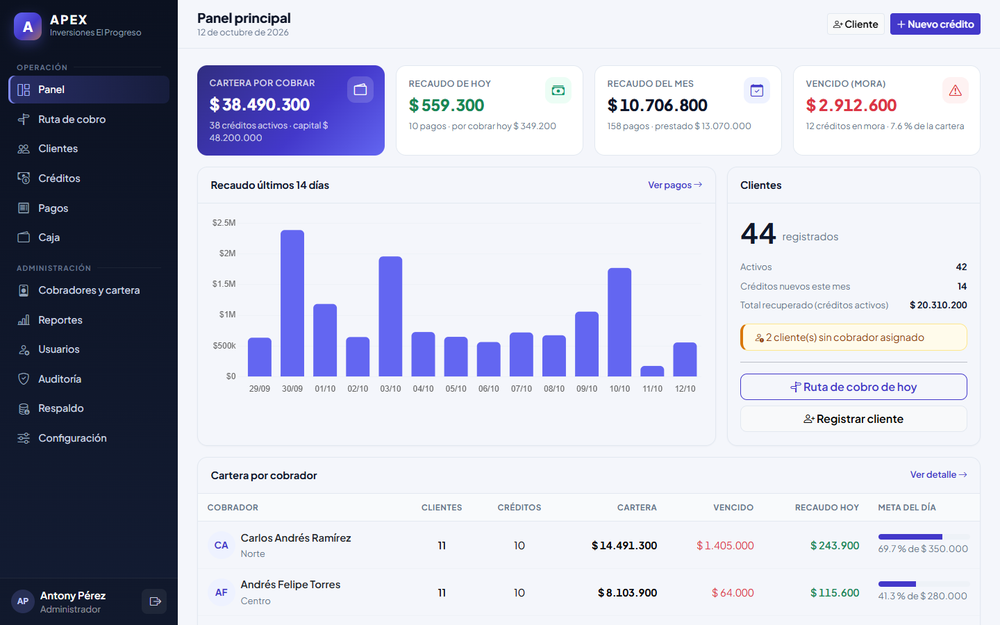
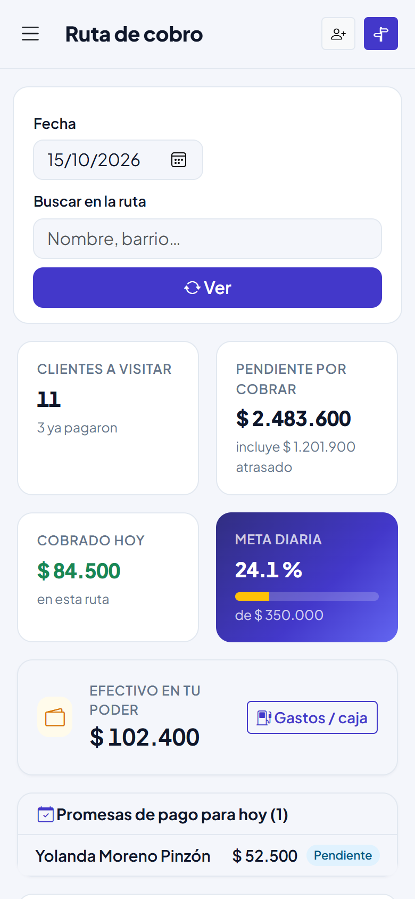
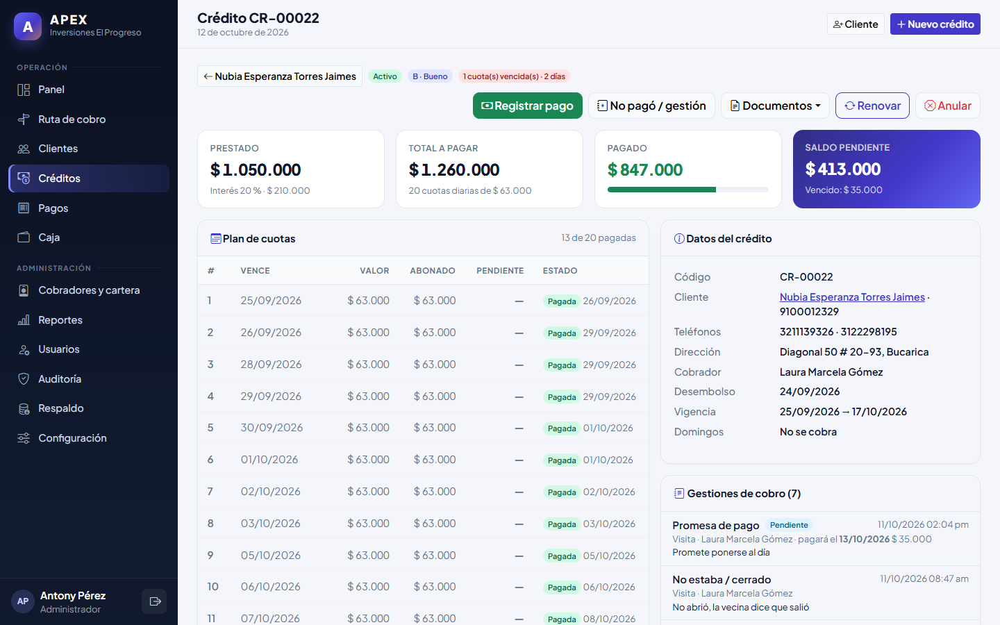
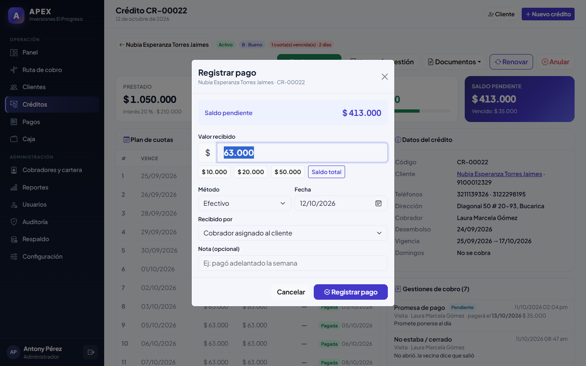
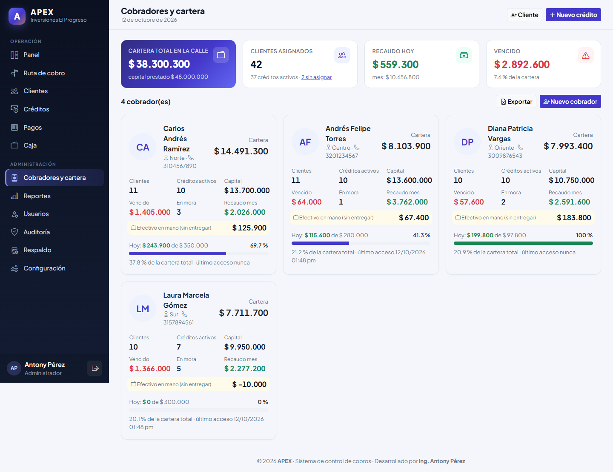
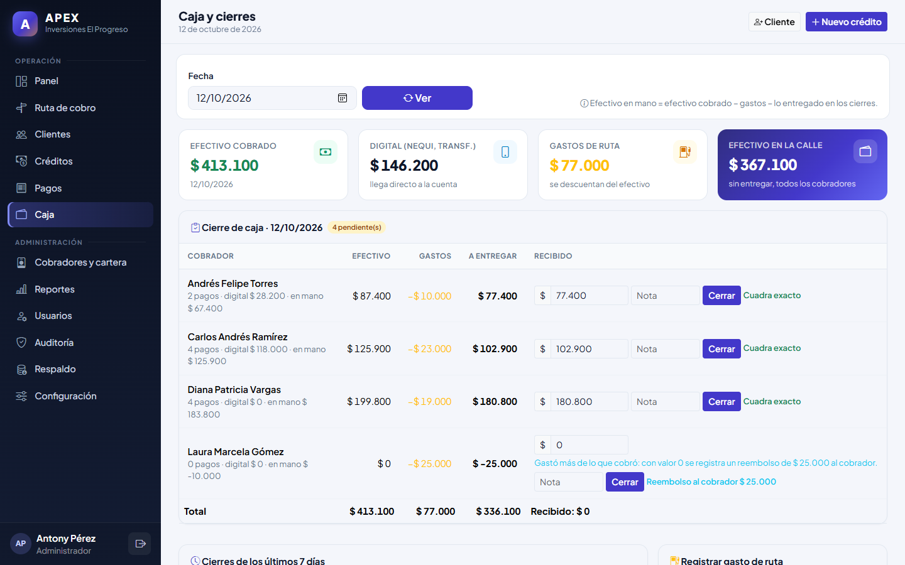
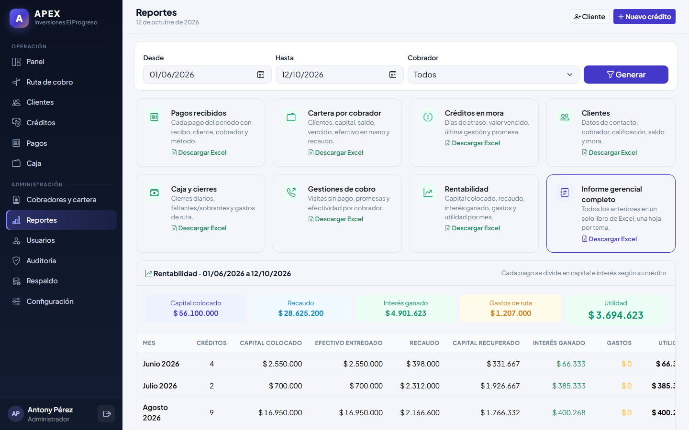
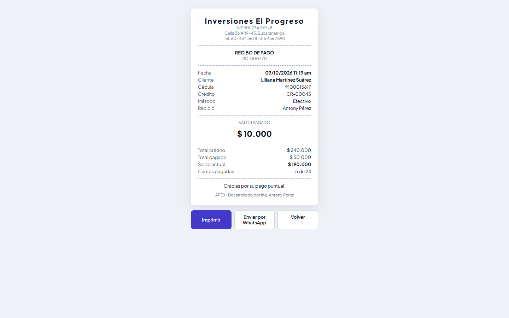

# APEX · Sistema de control de cobros

Desarrollado por **Ing. Antony Pérez**.

Aplicación web en PHP con arquitectura MVC propia (sin framework), MySQL/MariaDB y Bootstrap 5, para llevar el control de créditos, cuotas, pagos y la cartera que maneja cada cobrador.


**Contenido:** [Capturas](#capturas) · [Instalación](#instalación-xampp) · [Módulos](#módulos) · [Seguridad](#seguridad) · [Pasar a producción](#pasar-a-producción) · [Manuales](#manuales) · [Autor](#autor)

## Capturas

| Panel del administrador | Ruta de cobro (celular) |
|---|---|
|  |  |

| Ficha del crédito | Registro de pago |
|---|---|
|  |  |

| Cobradores y cartera | Caja y cierre diario |
|---|---|
|  |  |

| Reportes | Recibo |
|---|---|
|  |  |

Más de 60 capturas en [`docs/img/`](docs/img/).

## Instalación (XAMPP)

1. Copia la carpeta `ApexCobros` en `C:\xampp\htdocs\`.
2. Inicia **Apache** y **MySQL** desde el panel de XAMPP.
3. Importa la base de datos (phpMyAdmin → Importar → `database/schema.sql`) o ejecuta:
   ```
   C:\xampp\mysql\bin\mysql -uroot < C:\xampp\htdocs\ApexCobros\database\schema.sql
   ```
   ⚠️ El script **borra y vuelve a crear** las tablas: no lo ejecutes sobre una base con datos reales.
4. Revisa `.env` (URL, usuario y clave de la BD). En producción pon `APP_DEBUG=false`.
5. Abre http://localhost/ApexCobros

**Usuario inicial:** `admin` / `Admin123*`. En el primer ingreso el sistema **obliga** a cambiarla por una contraseña segura.

Si ya tenías una versión anterior instalada, aplica las migraciones en orden (no borran datos y se pueden repetir):
```
C:\xampp\mysql\bin\mysql -uroot < C:\xampp\htdocs\ApexCobros\database\migracion_seguridad.sql
C:\xampp\mysql\bin\mysql -uroot < C:\xampp\htdocs\ApexCobros\database\migracion_v12_funciones.sql
C:\xampp\mysql\bin\mysql -uroot < C:\xampp\htdocs\ApexCobros\database\migracion_v13_orden_ruta.sql
C:\xampp\mysql\bin\mysql -uroot < C:\xampp\htdocs\ApexCobros\database\migracion_v14_sin_conexion.sql
```

## Datos de prueba

```
C:\xampp\php\php.exe database\seed_demo.php           (carga 5 cobradores y 100 clientes con sus créditos, pagos, gestiones y caja)
C:\xampp\php\php.exe database\seed_demo.php --borrar  (elimina SOLO los datos de prueba)
```
Los cobradores de prueba son `demo.carlos`, `demo.laura`, `demo.andres`, `demo.diana` y `demo.jhon`, todos con la contraseña `Ruta#Segura2026`.
Los datos de prueba se identifican por el usuario `demo.*` y las cédulas que empiezan por `91000`; tus datos reales no se tocan.
Incluyen clientes puntuales, atrasados, morosos y adelantados, renovaciones, gestiones de cobro con promesas cumplidas e incumplidas, gastos de ruta, cierres de caja de los días anteriores (con algunos faltantes), un cliente bloqueado, clientes sin cobrador y un pago anulado.

Requisitos: PHP 8.1+, `mod_rewrite` habilitado (viene activo en XAMPP), extensión `pdo_mysql`.

## Módulos

| Módulo | Qué hace |
|---|---|
| **Panel** | Cartera por cobrar, recaudo de hoy y del mes, mora, gráfica de 14 días y cartera por cobrador. |
| **Clientes** | Cédula, nombres, apellidos, correo (opcional), 2 teléfonos, dirección, barrio, ciudad, fecha de nacimiento, ocupación, negocio, referencia personal, observaciones y cobrador asignado. Asignación masiva e historial de traslados. |
| **Créditos** | Monto, interés, número de cuotas y frecuencia (diaria, semanal, quincenal, mensual), opción de no cobrar domingos. Vista previa del plan en vivo. Plan de cuotas con estado (pagada, parcial, vencida). |
| **Pagos** | Abonos de cualquier valor: se aplican a las cuotas más antiguas. Recibo imprimible (80 mm) y envío por WhatsApp. Anulación con motivo (recalcula el crédito). |
| **Ruta de cobro** | Lo que cada cobrador debe recoger en el día (incluye atrasos), avance contra la meta y cobro con un toque. Pensado para el celular. |
| **Cobradores y cartera** | Por cobrador: clientes, créditos activos, capital prestado, dinero en cartera, vencido, créditos en mora, recaudo de hoy y del mes. Traslado de la cartera completa a otro cobrador. |
| **Caja** | Gastos de ruta del cobrador y cierre diario: el administrador recibe el efectivo, el sistema calcula lo que debía entregar (efectivo − gastos) y registra faltantes, sobrantes o reembolsos. Muestra el **efectivo en mano** de cada cobrador. |
| **Gestiones de cobro** | Cuando un cliente no paga se registra el motivo (no estaba, sin dinero, se niega…) o una **promesa de pago** con fecha y valor; el sistema la marca cumplida o incumplida según los pagos. Las promesas del día aparecen en la ruta y en el panel. |
| **Renovación** | Refinancia un crédito activo: el saldo pendiente se descuenta del nuevo monto y se muestra el efectivo neto a entregar. Si se anula la renovación, el crédito anterior revive con su saldo. |
| **Calificación del cliente** | A (excelente), B (bueno), C (regular), D (riesgoso) o N (sin historial), calculada con la puntualidad de todas sus cuotas y la mora actual. Se ve en clientes, créditos y al prestar (alerta si es D). |
| **Documentos** | Estado de cuenta imprimible/PDF, estado de cuenta en Excel y certificado de **paz y salvo** para créditos pagados. |
| **Reportes** | Liquidación de recaudo, rentabilidad mensual (capital colocado, interés ganado, gastos y utilidad) y cumplimiento de promesas. Exporta 8 reportes a **Excel (.xlsx) con diseño corporativo**: pagos, cartera, mora, clientes, caja, gestiones, rentabilidad e informe gerencial completo. |
| **Respaldo** | Descarga de una copia de seguridad completa de la base de datos (.sql). |
| **Usuarios** | Administradores y cobradores (usuario, clave, zona, meta diaria, activo/inactivo). |
| **Auditoría** | Bitácora de seguridad y de operaciones: quién hizo qué, cuándo y desde qué IP. |
| **Configuración** | Datos de la empresa para el recibo y valores por defecto de los créditos. |

## Roles

- **Administrador:** todo el sistema.
- **Cobrador:** ve solo **sus** clientes, créditos y pagos; su ruta y su cartera. Puede registrar clientes (quedan a su nombre) y registrar pagos (siempre con la fecha y hora actuales). No crea créditos, no anula pagos y no ve reportes.

## Reglas de negocio

- Total del crédito = capital × (1 + interés %). La cuota se redondea a la centena y la última ajusta la diferencia.
- Un pago no puede superar el saldo. Cuando el saldo llega a 0, el crédito pasa a **pagado**.
- Mora = cuotas no pagadas con fecha de vencimiento anterior a hoy.
- La cartera de un cobrador = suma de saldos de los créditos activos de los clientes que tiene asignados. Si un cliente se traslada, su saldo se mueve con él; los pagos ya recibidos quedan a nombre de quien los cobró.
- No se eliminan clientes con créditos ni usuarios con clientes o pagos: se desactivan.
- Un crédito solo se puede anular si no tiene pagos vigentes.

## Estructura

```
ApexCobros/
├── index.php              # Front controller
├── .htaccess              # URLs limpias y bloqueo de carpetas internas
├── .env                   # Configuración local
├── app/
│   ├── core/              # App (router), Controller, Model, Database, Auth, Security, Password, Env, Config
│   ├── controllers/       # Auth, Dashboard, Clientes, Creditos, Pagos, Ruta, Cobradores, Reportes, Usuarios, Configuracion, Perfil
│   ├── models/            # Usuario, Cliente, Credito, Pago, Caja, Gestion, Reporte, Auditoria, IntentoLogin, Configuracion
│   ├── services/          # Xlsx (generador de Excel sin dependencias) y ReporteExcel (diseño corporativo)
│   ├── views/             # Vistas por módulo + layouts
│   └── helpers/           # Funciones globales (money, fecha, csrf, flash…)
├── assets/                # CSS, JS, favicon
├── database/              # schema.sql, migraciones, seed_demo.php
├── tests/seguridad.php    # Pruebas de seguridad automatizadas
└── storage/logs/          # Log de errores
```

Rutas: `/controlador/accion/parametro`, por ejemplo `/clientes/ver/5` o `/creditos/crear`.

## Seguridad

| Área | Medida |
|---|---|
| Contraseñas | Mínimo 10 caracteres, mayúsculas, minúsculas, número y símbolo; no puede contener el usuario, nombre, cédula o correo ni palabras comunes. Hash **Argon2id** (las claves antiguas en bcrypt se migran solas al ingresar). Cambio obligatorio en el primer ingreso y cuando el administrador restablece una clave. Medidor de fortaleza en pantalla. |
| Fuerza bruta | Intentos guardados en BD: 5 fallos por usuario+IP, 10 por usuario o 20 por IP en 15 minutos bloquean el ingreso. No depende de la cookie del atacante. Mismo mensaje y tiempo de respuesta para usuario inexistente o clave errada. |
| Sesiones | Cookie `HttpOnly`, `SameSite=Lax`, `Secure` con HTTPS y modo estricto. Nuevo ID al ingresar. Cierre por inactividad (30 min) y duración máxima (12 h). En cada petición se revalida contra la BD: si desactivan al usuario, le cambian el rol o la clave, las sesiones abiertas se cierran o se actualizan al instante. |
| Cabeceras HTTP | Content-Security-Policy con *nonce* (sin scripts inline arbitrarios), X-Frame-Options, X-Content-Type-Options, Referrer-Policy, Permissions-Policy y COOP; HSTS bajo HTTPS. No se expone la versión de PHP. |
| Acceso | Control por rol y por cartera (un cobrador no puede ver ni modificar lo de otro), CSRF en todos los POST, acciones de cambio solo por POST, campos sensibles ignorados si los envía un cobrador. |
| Entradas | Consultas preparadas (PDO), escape de toda salida, valores de dinero validados estrictamente (se rechazan negativos, decimales o texto), parámetros tipo arreglo ignorados, longitudes recortadas, protección contra inyección de fórmulas en CSV y sin redirecciones abiertas. |
| Servidor | `.htaccess` bloquea `app/`, `database/`, `storage/`, `tests/`, archivos ocultos, `.md`, `.sql`, `.log`, cualquier `.php` distinto de `index.php` y los métodos HTTP no usados. `APP_DEBUG=false` oculta los errores internos. |
| Auditoría | Módulo **Auditoría** (solo administrador): ingresos, fallos, bloqueos, accesos denegados, cambios de usuarios, clientes, créditos, pagos, configuración y exportaciones, con IP y navegador. |

### Pruebas de seguridad

```
C:\xampp\php\php.exe tests\seguridad.php
```
Ejecuta 93 pruebas automáticas (exposición de archivos, cabeceras, fuerza bruta, fijación y robo de sesión, política de contraseñas, escalada de privilegios, IDOR, CSRF, inyección SQL, XSS, validación de montos, inyección de fórmulas en Excel, redirección abierta, router, caja, gestiones, renovaciones, documentos y respaldo…). Crea datos temporales (`sectest_*`, cédulas `999000…`), los borra al final y deja el informe en `tests/resultado_seguridad.md`.

### Recomendaciones para producción

- Publicar con **HTTPS** (activa automáticamente la cookie `Secure` y HSTS).
- En `C:\xampp\apache\conf\httpd.conf` poner `ServerTokens Prod` y `ServerSignature Off` para no revelar la versión de Apache.
- Crear un usuario de MySQL propio para la app (no `root`) con contraseña, y ponerlo en `.env`.
- Hacer copias de seguridad diarias de la base de datos.

---
© APEX · Desarrollado por Ing. Antony Pérez

## Reportes de Excel

Los reportes se generan como archivos **.xlsx reales** con un generador propio (`app/services/Xlsx.php`), sin Composer y sin la extensión `zip` de PHP (XAMPP la trae desactivada). Cada hoja tiene encabezado corporativo con empresa, título, periodo y quién lo generó; tarjetas de indicadores; tabla con filas alternadas, formatos de moneda, fecha y porcentaje; colores por estado (mora, calificación, faltantes); totales con fórmulas `SUBTOTAL` que se recalculan al filtrar; filtros, encabezado fijo y configuración de impresión (horizontal, ajustada al ancho, con número de página).

## Trabajo sin conexión

**Consultar (todo el aplicativo).** Cada pantalla que se abre con señal queda guardada en el equipo (`sw.js`, service worker).
Además, cada 30 minutos se guardan las pantallas principales (panel, ruta, clientes, créditos, pagos, caja, cartera) y,
desde la ruta, la ficha de cada cliente y de cada crédito del día. Sin señal se muestra la última copia con el aviso
"Sin conexión · copia guardada el …". Una pantalla nunca abierta con señal muestra la lista de las que sí están guardadas.
No se guardan descargas (Excel, respaldo) ni el ingreso. Las copias se borran al cerrar sesión.

**Registrar.** Sin conexión solo se registra desde la ruta de cobro (abajo). Cualquier otra acción (crear créditos,
renovar, anular, cierres de caja, clientes, usuarios, configuración…) necesita internet: sin señal el formulario no se
envía, se avisa y lo escrito se conserva.

### Ruta de cobro sin conexión

La ruta de cobro sigue funcionando aunque el cobrador se quede sin internet:

- **Con señal** cada visita a la ruta guarda en el celular una copia de la ruta y de la hoja de ruta.
- **Sin señal** la ruta abre desde esa copia. Los cobros, los "no pagó" y el orden de la ruta quedan en el celular
  (`assets/js/offline.js`, IndexedDB) y la tarjeta del cliente lo indica. Si la señal es tan débil que el envío no responde
  en 12 segundos, también se guarda en el celular.
- **Al volver la señal** se envía todo solo, uno por uno y en el orden en que se registró (`SincronizarController`).
  Cada operación lleva un identificador único (`operaciones_offline`): aunque llegue dos veces, se registra una sola.
- El pago conserva la hora real del cobro (máximo 7 días atrás). Si ese día ya tenía cierre de caja, entra con la fecha
  del envío y la nota indica cuándo se cobró. Todos llevan en la nota "Registrado sin conexión".
- Si la sesión venció mientras no había señal, nada se pierde: al volver a ingresar con el mismo usuario se envía.
  Lo que el servidor rechace (por ejemplo, un valor mayor al saldo) queda en el panel de la ruta para reintentar o descartar.
- Al cerrar sesión se borran del celular las copias de páginas con datos de clientes; lo pendiente por enviar se conserva.
- Se puede **instalar como aplicación** desde el navegador del celular ("Agregar a la pantalla de inicio").

**Requisito:** en producción el sitio debe estar en **HTTPS**; los navegadores solo permiten el trabajo sin conexión
en `https://` (o en `localhost`). Con `http://` desde otro equipo la ruta funciona, pero solo con internet.

## Pasar a producción

1. **Verificar que todo funcione** (crean datos temporales y los borran al terminar):
   ```
   C:\xampp\php\php.exe tests\seguridad.php          (93 pruebas de seguridad)
   C:\xampp\php\php.exe tests\prueba_funcional.php   (32 pasos del flujo completo del negocio)
   ```
2. **Dejar el sistema limpio** (primero sin `--confirmar` para ver qué se borraría):
   ```
   C:\xampp\php\php.exe database\limpiar_produccion.php --confirmar
   ```
   Guarda un respaldo en `storage\backups\`, borra clientes, créditos, pagos, caja, gestiones, auditoría y cobradores,
   conserva los administradores y la configuración, y reinicia los consecutivos (CR-00001, RC-000001).
   Con `--reiniciar-admin` el usuario admin vuelve a la clave inicial `Admin123*` (cambio obligatorio al entrar).
3. **Revisión final** (solo lectura, no modifica nada; deja el informe en `tests\resultado_produccion.md`):
   ```
   C:\xampp\php\php.exe tests\verificar_produccion.php
   ```
   Después de limpiar, no vuelvas a correr los pasos del punto 1: aunque borran sus datos, consumen consecutivos
   y el primer crédito real ya no sería CR-00001.
4. **Configurar la empresa**: menú Configuración → nombre, NIT, teléfono y dirección (salen en recibos y documentos).
5. **Crear los cobradores** en Usuarios. Cada uno deberá cambiar su contraseña en el primer ingreso.
6. **Antes de publicar en internet**:
   - Certificado HTTPS y `APP_URL=https://...` en `.env`.
   - Usuario de MySQL propio con contraseña (no `root`), por ejemplo en phpMyAdmin → Cuentas de usuario,
     con permisos solo sobre `apex_cobros_db`; luego actualizar `DB_USER` y `DB_PASS` en `.env`.
   - En `C:\xampp\apache\conf\httpd.conf`: `ServerTokens Prod` y `ServerSignature Off`, y reiniciar Apache.
   - Programar un respaldo diario (menú Respaldo) y guardar la copia fuera del equipo.

## Manuales

En `docs/` (también disponibles dentro del sistema en el menú **Ayuda**, según el rol):

| Manual | Para |
|---|---|
| [Manual del Administrador](docs/APEX_01_Manual_del_Administrador.pdf) | Administradores: todos los módulos paso a paso |
| [Manual del Cobrador](docs/APEX_02_Manual_del_Cobrador.pdf) | Cobradores: uso desde el celular |
| [Guía de Inicio Rápido](docs/APEX_03_Guia_de_Inicio_Rapido.pdf) | Todos: tareas frecuentes |
| [Procedimientos Operativos](docs/APEX_04_Procedimientos_Operativos.pdf) | Rutinas diarias, semanales y mensuales |
| [Manual de Instalación y Producción](docs/APEX_05_Manual_de_Instalacion_y_Produccion.pdf) | Soporte técnico: instalación, respaldos, problemas |
| [Manual Técnico](docs/APEX_06_Manual_Tecnico.pdf) | Desarrolladores: arquitectura, base de datos, reglas |
| [Manual de Seguridad](docs/APEX_07_Manual_de_Seguridad.pdf) | Políticas, auditoría, incidentes, datos personales |

Las fuentes están en `docs/fuente/` (HTML + CSS). Para regenerarlos ver [`docs/fuente/LEEME.md`](docs/fuente/LEEME.md).

## Autor

**Ing. Antony Pérez** · [@Aperez27](https://github.com/Aperez27)

© 2026 Antony Pérez. Todos los derechos reservados.
